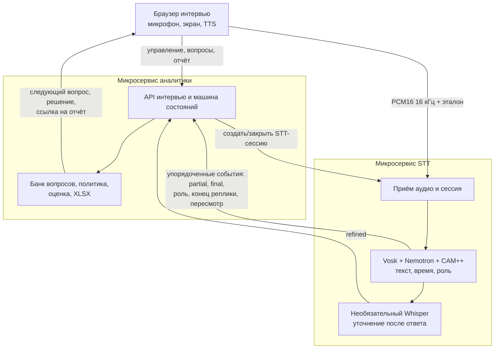

# Предлагаемое разделение на STT и аналитику

Это **проектная схема**, а не описание уже реализованных маршрутов. Текущее демо состоит из Java worker и Spring Boot сервиса; его подтверждённое устройство описано в [архитектуре прототипа](README.md). Разделение ниже позволит развертывать распознавание с тяжёлыми моделями отдельно от правил интервью и отчётов.

## Граница ответственности

| STT | Аналитика |
| --- | --- |
| Принимает PCM и эталон голоса, управляет загрузкой Vosk/Nemotron/CAM++, распознаёт слова и роли, определяет конец речевой реплики. | Управляет вопросами и фазами интервью, принимает или отменяет решение, считает оценки и формирует XLSX. |
| Выдаёт события текста, временных меток, уверенности роли, конца и возобновления речи; может уточнять завершённый ответ через Whisper. | Получает только события и метаданные, принимает в ответ кандидата подтверждённую речь; предварительные события использует лишь для подсказки. |
| Хранит тяжёлые модели и диагностические аудиоданные по своей политике хранения. | Хранит состояние интервью, банк вопросов, результаты и отчёты; не загружает ASR-модели и не обрабатывает сырое аудио. |

## Предлагаемый поток одной сессии

1. Браузер создаёт интервью в аналитике. Аналитика создаёт связанную STT-сессию и получает её идентификатор. Браузер отправляет эталон и затем аудиокадры непосредственно в STT.
2. STT публикует события с `sessionId`, монотонным `sequence`, `utteranceId`, временными метками и статусом `partial`/`final`/`revision`. Отдельно передаются роль и её статус `preliminary`/`confirmed`, а также конец или возобновление реплики.
3. Аналитика применяет события по порядку, игнорирует повторные `sequence` и считает ответом только подтверждённую речь кандидата. Она решает, нужно ли уточнение или следующий вопрос; окно отмены остаётся её бизнес-правилом. Браузер показывает вопрос и озвучивает его через TTS.
4. Уточнение Whisper приходит позднее как версия того же `utteranceId`. Оно обновляет текст и итоговый отчёт, не превращая предварительную подсказку в окончательное решение.

На первом этапе достаточно **закрытого потока STT → аналитика с одним активным потребителем на сессию** и ограниченной очередью. Для восстановления после разрыва нужны подтверждение последнего `sequence` и повторная выдача недоставленных событий; без этого потеря связи должна завершать сессию явной ошибкой. Брокер сообщений имеет смысл добавлять, когда понадобятся независимые потребители, горизонтальное масштабирование или долговременное повторное воспроизведение. Его введение не меняет границу двух бизнес-сервисов.

## Переход от текущего кода

1. Выделить из `vosk-stt-demo` Vosk, `SpeechSession`, детектор конца речи и Whisper-клиент в STT; туда же отнести `NemotronStream`, `OnlineRoles` и захват эталона из worker. Сначала закрепить единый формат событий и тесты на роль, время и пересмотр слов.
2. Оставить в аналитике `InterviewSession`, `DecisionPolicy`, банк вопросов и Excel-экспорт. Вместо сырых PCM-кадров она получает события конца и возобновления речи от STT. Убрать прямое создание Vosk-сессии из обработчика интервью.
3. Заменить `IntegrationBridge` адаптером событий STT; сохранить временно существующий браузерный HTTP API `:8765` как совместимый вход, пока страница не перейдёт на новые интерфейсы. Новые маршруты и сообщения сначала проектируются и тестируются, затем добавляются в контракты; приведённые здесь имена событий пока **не являются действующим API**.

Отдельную схему **текущей** архитектуры по договорённости добавит сокомандник в [основной раздел](README.md#место-для-схемы-сокомандника).
