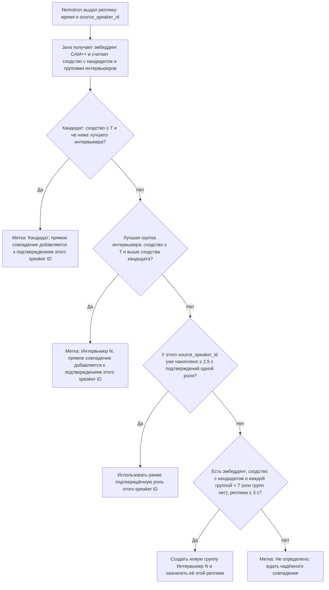

# Java worker диаризации

Java-перенос `stream_replay.py` и `verify_candidate.py`. Используются те же локальные модели Nemotron 3 Diarization (GGUF) и 3D-Speaker CAM++ (ONNX). Немотрон вызывается через его C API и JNA, эмбеддинги — через Java API sherpa-onnx. Весь анализ выполняется на CPU сервера. Файлы моделей и аудио в Git не входят; worker их не скачивает.

## Что получается на выходе

- `stream`: `events.jsonl` (строка JSON на каждый буфер), `segments.json` (завершённые реплики), `summary.json` (время и счётчики). Названия полей и структура сохранены от Python-скрипта. Показатели времени отражают конкретный запуск и не обязаны совпадать по числам.
- `live`: те же три файла для настоящего микрофона. `events.jsonl` и `segments.json` обновляются во время разговора; `summary.json` обновляется после каждого буфера и получает итоговый признак `finished: true` при штатной остановке.
- `verify`: `*.verified.json` и `*.verified.csv` с теми же полями, порядком колонок, UTF-8 BOM и переводами строк, что у Python-скрипта.

Обе модели загружаются по одному разу за прогон. В `stream` открывается одна сессия Nemotron; буферы по 0,64 с поступают в неё последовательно, а состояние говорящих сохраняется между буферами. Эталон кандидата заранее берётся из окна 20–30 с исходного файла. Это именно способ воспроизвести тест: в продукте эталон должен приходить от кнопки записи голоса кандидата. В этих результатах нет текста слов: STT не подключена.

В `live` эталон действительно записывается с микрофона: после первого отсчёта 3–2–1 нужно говорить 10 секунд; в последние три секунды записи идёт второй отсчёт 3–2–1. Затем отдельный поток непрерывно читает микрофон и передаёт буферы через ограниченную очередь одному потоку обработки с одной открытой сессией Nemotron. CAM++ вычисляет эталон один раз и далее сравнивает голоса с ним. Время сегментов в `live` отсчитывается от **начала основной записи после регистрации эталона**. Файловый режим `stream` и его формат не менялись.

## Браузерный микрофон: одна кнопка Run в IntelliJ IDEA

Откройте Maven-проект и выберите подготовленный SDK, как описано ниже в разделе «Запуск в IntelliJ IDEA с нуля». Создайте конфигурацию **Application**: Main class `ru.aireferent.diarization.Main`, module classpath `diarization-worker`, JRE `C:\Users\Public\NemotronTest\java-idea-sdk`, working directory `server-prototype/java`. В **Program arguments** укажите:

```text
browser --nemo-lib "C:\Users\Public\NemotronTest\runtime\bin\nemo_speech_asr_c.dll" --nemo-model "C:\Users\Public\NemotronTest\model.gguf" --speaker-model "C:\Users\Public\NemotronTest\speaker_embedding_model.onnx" --output-dir "C:\Users\Public\NemotronTest\java-browser-run"
```

Нажмите **Run**: страница откроется в браузере автоматически. Если этого не произошло, откройте `http://localhost:8765` на этом компьютере. По первому нажатию «Записать голос кандидата» разрешите доступ к микрофону и говорите около 10 секунд. Повторное нажатие завершит эталон; после сообщения «Можно говорить» начнётся анализ. Кнопка «Завершить интервью» дочитает принятую очередь и запишет итог. Нажатие **Stop** в IntelliJ принудительно завершает процесс и не гарантирует итоговый `summary.json`.

Java-сервер слушает только `127.0.0.1:8765`. Браузер передаёт только микрофон: `AudioWorklet` переводит звук в моно PCM16 16 кГц и отправляет его буферами по 0,64 с. Java проверяет номера чанков, передаёт их одной сессии Nemotron, а CAM++ сопоставляет речь с записанным эталоном. На странице видна предварительная роль; подробные JSON-события идут в консоль. Для каждого интервью в `--output-dir` создаётся отдельная папка с `events.jsonl`, `segments.json`, `summary.json`. Время сегментов отсчитывается с начала основной записи после эталона.

В итоговых сегментах рядом с текстовой `confidence` записывается целое `confidence_percent`. Это **эвристический показатель силы решения, а не вероятность его правильности**. Числа 0–49 соответствуют `низкая`, 50–74 — `средняя`, 75–99 — `высокая`; 100 зарезервировано для заранее известного эталона. На выбор диапазона влияют прохождение порога сходства, длительность реплики и запасной выбор по speaker ID. Внутри диапазона число растёт по сходству с выбранным голосом и отрыву от альтернативы; при создании новой группы — по отличию от кандидата. Пока показатель не откалиброван на размеченных интервью, его нельзя трактовать как точность в процентах. `candidate_similarity` и `interviewer_similarity` остаются исходными косинусными сходствами, а не вероятностями.

Роль speaker ID теперь закрепляется только после суммарно 2,5 с реплик с прямым голосовым совпадением или после создания группы другого голоса по реплике от 3 с. Короткие участки без эмбеддинга и сходства ниже порогов получают `Не определено` с `confidence_percent: 0`, если для их speaker ID ещё нет подтверждённой роли. Такие участки не добавляют голосов за роль и не наследуют метку предыдущей реплики. В `decision` каждого сегмента указана фактически сработавшая ветка правила.

## Как сейчас проходит одна реплика

Nemotron определяет границы реплики и выдаёт свой `source_speaker_id`. Затем Java вызывает CAM++: тот строит эмбеддинг реплики, а Java сравнивает его с эталоном кандидата и с уже созданными группами интервьюеров. **Номера `Интервьюер 1`, `Интервьюер 2` назначает Java**, а не Nemotron. Ветви ниже идут именно в этом порядке. `T` — порог сходства; по умолчанию `0.60`.



- Если и сходство с кандидатом, и сходство с лучшей группой интервьюера достигают `T`, выбирается большее; при равенстве выбирается кандидат.
- Проверка прежней роли `source_speaker_id` выполняется **до** создания новой группы. Если прямого совпадения нет, но для этого ID уже набралось не менее 2,5 с подтверждений одной роли, применяется эта роль.
- Новая группа интервьюера создаётся только при наличии эмбеддинга, когда сходство с кандидатом и всеми существующими группами ниже `T` (либо групп ещё нет), а текущая реплика длится не менее 3 с. До выполнения условий новая группа не создаётся.
- Иначе сегмент получает `Не определено`. Если Nemotron выдал реплику, она остаётся в `segments.json` с этой меткой; исходный звук в текущем режиме не сохраняется. Если Nemotron вообще не выдал сегмент, записи о такой реплике в `segments.json` не будет.
- `confidence` и `confidence_percent` рассчитываются отдельно от выбора ветки: это эвристическая оценка силы уже принятого решения, не вероятность правильности. Конкретная ветка записывается в поле `decision`.

Если эталон слишком короткий или тихий, страница предложит записать его снова. Если доступ к микрофону запрещён, ошибка появится на странице. Если вкладка закрыта во время интервью, через примерно 15–20 секунд без связи Java завершит обработку принятых чанков и сохранит файлы с `finished: false`. Очередь по умолчанию вмещает 32 чанка; её переполнение останавливает текущую сессию и отмечается в `summary.json`. Запись системного звука и восстановление после переполнения пока не подключены.

## Живой микрофон: одна кнопка Run в IntelliJ IDEA

1. Выполните общие шаги 1–2 из раздела «Запуск в IntelliJ IDEA с нуля» ниже: откройте Maven-проект и добавьте подготовленный SDK.
2. Создайте конфигурацию **Application** с именем `Nemotron live microphone`. Main class: `ru.aireferent.diarization.Main`; module classpath: `diarization-worker`; working directory: каталог `server-prototype/java`; **JRE**: `C:\Users\Public\NemotronTest\java-idea-sdk`. Для русского текста в консоли при необходимости укажите VM options `-Dsun.stdout.encoding=UTF-8 -Dsun.stderr.encoding=UTF-8`.
3. Вставьте в **Program arguments** одну строку:

```text
live --nemo-lib "C:\Users\Public\NemotronTest\runtime\bin\nemo_speech_asr_c.dll" --nemo-model "C:\Users\Public\NemotronTest\model.gguf" --speaker-model "C:\Users\Public\NemotronTest\speaker_embedding_model.onnx" --output-dir "C:\Users\Public\NemotronTest\java-live-run" --chunk-seconds 0.64
```

4. Нажмите **Run**. После загрузки моделей начнётся первый отсчёт. Говорите только своим голосом во время 10-секундной регистрации. После сообщения «Эталон готов» начинается основная запись. Консоль показывает JSON-событие на каждый буфер: `active_speakers` — предварительная роль сейчас, `segments` — только завершённые участки. Если модель ещё не выдала говорящего, массивы могут быть пустыми.
5. Для штатной остановки нажмите **Enter** в консоли Run. Поток захвата остановится, а обработка дочитает очередь, завершит Nemotron и запишет окончательные `segments.json` и `summary.json`. Можно также добавить `--max-seconds 30`, чтобы захват завершился сам через 30 секунд основной части. Если остановить процесс кнопкой **Stop**, `events.jsonl`, `segments.json` и промежуточный `summary.json` останутся на диске, но последний может содержать `finished: false`.

Приложение слушает **только микрофон**, согласно текущему варианту теста. Звук приложений, который не попадает в микрофон (например, собеседник в наушниках), в эту сессию не поступает. Для выбора другого микрофона запустите ту же Main class с единственным аргументом `live-devices`, затем добавьте к основной конфигурации `--mic-name "часть имени устройства"`. Нужен доступ Windows к микрофону для классических приложений. Если в десятисекундном эталоне недостаточно слышной речи, программа сообщит об ошибке и предложит повторить запуск.

В живом режиме сохраняются временные метки, speaker ID, роли, оценки сходства и задержки, как в файловом `stream`. В событии `chunk` появились `captured_wall_s` (время завершения захвата чанка), `queue_wait_s` (ожидание до начала его обработки) и `queue_depth_chunks` (сколько чанков ждёт после обработки текущего). Старое `backlog_s` осталось для сравнения со старыми прогонами: это разница между временем запуска и длительностью переданного модели аудио, а не размер очереди. В `summary.json` объект `capture` содержит максимальную глубину очереди, распределение времени ожидания, число переполнений и потерянных чанков.

Очередь по умолчанию вмещает 32 чанка, то есть около 20,48 с при `--chunk-seconds 0.64`. Параметр `--queue-chunks N` меняет предел. При заполнении очереди приложение **останавливает захват**, учитывает один не принятый чанк как потерянный, обрабатывает уже принятые чанки и сохраняет `finished: false` с `capture.stop_reason: "queue_overflow"`. Это предотвращает скрытый пропуск речи и сдвиг временных меток в единственной сессии Nemotron. Отдельный поток защищает захват от блокировки на `push()`, но не ускоряет Nemotron: если CPU систематически медленнее входящего аудио, очередь растёт.

Это автоматические оценки. Речь не переводится в текст: STT здесь не подключена.

## Требования

- Windows x64, JDK 17+ и Maven 3; здесь проверено с Java 23 и Maven 3.9.
- Локальные файлы `nemo_speech_asr_c.dll` и связанных DLL, GGUF Nemotron, ONNX CAM++ и WAV PCM16 16 кГц.
- Доступ Maven к Maven Central и JitPack при первой сборке Java-библиотек. Это зависимости сборки на машине разработчика или сервере, а не загрузка моделей на ноутбук интервьюера.

**Для установленного здесь JDK 23 нужен отдельный Java SDK.** В его `bin` лежит старый `msvcp140.dll` (14.36), а поставка Nemotron использует 14.44. Обычный запуск Java с этим JDK вызывает сбой нативной библиотеки. Скрипт ниже создаёт отдельную копию запускаемых файлов JDK с совместимыми DLL, сохраняя установленный JDK и модель без изменений:

```powershell
cd 'C:\Users\Ефим\OneDrive\Документы\ChatGPT\AI референт\stt-module\server-prototype\java'
.\prepare-windows-jdk.ps1 `
  -JdkHome 'C:\Program Files\Java\jdk-23' `
  -NemoBin 'C:\Users\Public\NemotronTest\runtime\bin' `
  -Target 'C:\Users\Public\NemotronTest\java-idea-sdk'
```

Если ваша установка JDK уже совместима с DLL Nemotron, используйте её напрямую. Указанная проблема относится к конкретным версиям установленного здесь JDK и нативной поставки.

## Запуск в IntelliJ IDEA с нуля

1. Откройте IntelliJ IDEA → **Open** → выберите `server-prototype/java/pom.xml` → **Open as Project**. Дождитесь **Load Maven Changes**. Если Maven не найден, укажите установленный Maven в **Settings → Build Tools → Maven**.
2. В **File → Project Structure → SDKs** добавьте SDK из `C:\Users\Public\NemotronTest\java-idea-sdk`, затем выберите его как **Project SDK**. Язык проекта — Java 17; запуск здесь проверен на подготовленном Java 23.
3. Откройте **Run → Edit Configurations → + → Application**. Main class: `ru.aireferent.diarization.Main`. Module classpath: `diarization-worker`. JRE: подготовленный SDK. Working directory: каталог `server-prototype/java`. Для корректного отображения русского текста в консоли можно добавить VM option `-Dfile.encoding=UTF-8`.
4. В **Program arguments** вставьте команду ниже целиком одной строкой (переносы здесь только для чтения):

```text
stream --audio "C:\Users\Ефим\OneDrive\Документы\ChatGPT\AI референт\diarization-test\ru_interview_dialogue_125s.wav" --nemo-lib "C:\Users\Public\NemotronTest\runtime\bin\nemo_speech_asr_c.dll" --nemo-model "C:\Users\Public\NemotronTest\model.gguf" --speaker-model "C:\Users\Public\NemotronTest\speaker_embedding_model.onnx" --output-dir "C:\Users\Public\NemotronTest\java-idea-run" --chunk-seconds 0.64 --pace realtime
```

5. Нажмите **Run**. Для быстрого прогона замените `--pace realtime` на `--pace fast`. Чтобы ограничить тест первыми секундами, добавьте, например, `--max-seconds 35`. Тест полного интервью состоит из 196 буферов. В консоли идут JSON-события; в выходном каталоге появятся три файла. Нативная библиотека sherpa-onnx может отдельно напечатать диагностическую строку в stderr при загрузке; формат `events.jsonl` от этого не меняется.

**Проверка JRE в конфигурации.** Первая строка окна Run должна начинаться с `"C:\Users\Public\NemotronTest\java-idea-sdk\bin\java.exe"`. Если там `"C:\Program Files\Java\jdk-23\bin\java.exe"`, откройте **Run → Edit Configurations → diarization-worker**, нажмите **Modify options → Add JRE** (если поле скрыто) и в поле **JRE** выберите подготовленный `java-idea-sdk`. Одной настройки Project SDK может быть недостаточно, если конфигурация запуска использует другой JRE. При несовместимой версии `msvcp140.dll` worker теперь сообщает об этом до нативного вызова.

Для файловой проверки создайте вторую конфигурацию **Application** с тем же Main class и SDK, но с такими аргументами:

```text
verify --audio "C:\Users\Ефим\OneDrive\Документы\ChatGPT\AI референт\diarization-test\ru_interview_dialogue_125s.wav" --diarization-json "C:\Users\Public\NemotronTest\result_ru_dialogue_125s.json" --model "C:\Users\Public\NemotronTest\speaker_embedding_model.onnx" --output "C:\Users\Public\NemotronTest\java-idea-verify.json" --csv "C:\Users\Public\NemotronTest\java-idea-verify.csv"
```

Если JSON Nemotron ещё не создан, вместо `--diarization-json` передайте `--nemo-exe "...\nemo-speech.exe" --nemo-model "...\model.gguf"`. Для отдельного отладочного WAV эталона можно указать `--reference-wav PATH`.

## Запуск из терминала

В каталоге `server-prototype/java`:

```powershell
mvn package
& 'C:\Users\Public\NemotronTest\java-idea-sdk\bin\java.exe' -jar target\diarization-worker-1.0.0.jar stream `
  --audio 'C:\Users\Ефим\OneDrive\Документы\ChatGPT\AI референт\diarization-test\ru_interview_dialogue_125s.wav' `
  --nemo-lib 'C:\Users\Public\NemotronTest\runtime\bin\nemo_speech_asr_c.dll' `
  --nemo-model 'C:\Users\Public\NemotronTest\model.gguf' `
  --speaker-model 'C:\Users\Public\NemotronTest\speaker_embedding_model.onnx' `
  --output-dir 'C:\Users\Public\NemotronTest\java-idea-run' --pace fast
```

## Проверка совместимости

На том же русском WAV длительностью 125 с Java выдала 196 событий `chunk` и 22 итоговых сегмента. Для каждого из 22 сегментов совпали с Python границы, роль, speaker ID, сходства, уверенность и основание решения. Счётчики: 13 «Кандидат», 8 «Интервьюер 1», 1 эталон. В файловом режиме JSON и CSV при одинаковом входе совпали с Python **побайтно**. Значения задержек и времени загрузки в потоковом режиме зависят от конкретного запуска.
